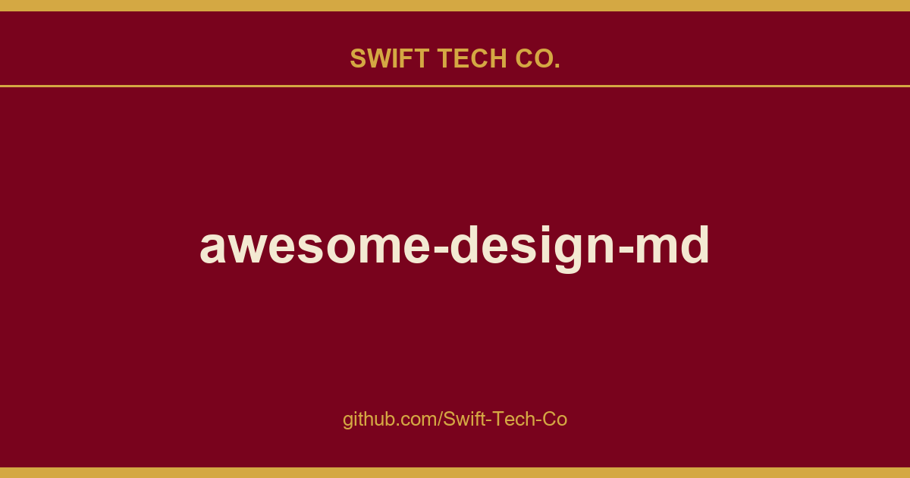

# awesome-design-md

## What This Is

A practical reference entry for product and engineering: the awesome-design-md notes, examples and fixes we reach for repeatedly. Kept current as part of the wider Swift Tech Co. engineering library.

## Images

## What is DESIGN.md?

DESIGN.md is a new concept introduced by Google Stitch. A plain-text design system document that AI agents read to generate consistent UI.

It's just a markdown file. No Figma exports, no JSON schemas, no special tooling. Drop it into your project root and any AI coding agent or Google Stitch instantly understands how your UI should look. Markdown is the format LLMs read best, so there's nothing to parse or configure.

| File | Who reads it | What it defines |
|------|-------------|-----------------|
| `AGENTS.md` | Coding agents | How to build the project |
| `DESIGN.md` | Design agents | How the project should look and feel |

**This repo provides ready-to-use DESIGN.md files** extracted from real websites. 

## Request a DESIGN.md

You can request a DESIGN.md for specific website, including private requests delivered exclusively to you.

## AI Design + Build Ecosystem Tools

 

You ship products with AI, but every launch still dies quietly because nobody posts about it. EveryFeed plugs your AI assistant into a social workspace that drafts, schedules, and publishes across 35+ channels  no agency, no marketing hire.

<a href="https://www.swifttechco.com">
 
</a>

 

<a href="https://www.swifttechco.com">
 
</a>

 

<a href="https://www.swifttechco.com">
 
</a>

 

<table>
<tr>
<td align="center" width="100%">

<h4>👉 Feature your product alongside the developers, designers, and vibecoders shipping UI with AI coding agents and web builders.</h4>

Ranked #150 globally on GitHub. A community resource used by developers, designers, and vibecoders.

</td>
</tr>
</table>

## Collection

### AI & LLM Platforms

- **Claude** - Anthropic's AI assistant. Warm terracotta accent, clean editorial layout
- **Cohere** - Enterprise AI platform. Vibrant gradients, data-rich dashboard aesthetic
- **ElevenLabs** - AI voice platform. Dark cinematic UI, audio-waveform aesthetics
- **Minimax** - AI model provider. Bold dark interface with neon accents
- **Mistral AI** - Open-weight LLM provider. French-engineered minimalism, purple-toned
- **Ollama** - Run LLMs locally. Terminal-first, monochrome simplicity
- **OpenCode AI** - AI coding platform. Developer-centric dark theme
- **Replicate** - Run ML models via API. Clean white canvas, code-forward
- **Runway** - AI creative-tools platform with an editorial film-festival aesthetic  cinematic dark heroes, paper-white reading bands, single proprietary sans, and pure black pill CTAs.
- **Together AI** - Open-source AI infrastructure. Technical, blueprint-style design
- **VoltAgent** - AI agent framework. Void-black canvas, emerald accent, terminal-native
- **xAI** - Elon Musk's AI lab. Stark monochrome, futuristic minimalism

### Developer Tools & IDEs

- **Cursor** - AI-first code editor. Sleek dark interface, gradient accents
- **Expo** - React Native platform. Dark theme, tight letter-spacing, code-centric
- **Lovable** - AI full-stack builder. Playful gradients, friendly dev aesthetic
- **Raycast** - Productivity launcher. Sleek dark chrome, vibrant gradient accents
- **Superhuman** - Fast email client. Premium dark UI, keyboard-first, purple glow
- **Vercel** - Frontend deployment platform. Black and white precision, Geist font
- **Warp** - Modern terminal. Dark IDE-like interface, block-based command UI

### Backend, Database & DevOps

- **ClickHouse** - Fast analytics database. Yellow-accented, technical documentation style
- **Composio** - Tool integration platform. Modern dark with colorful integration icons
- **HashiCorp** - Infrastructure automation. Enterprise-clean, black and white
- **MongoDB** - Document database. Green leaf branding, developer documentation focus
- **PostHog** - Product analytics. Playful hedgehog branding, developer-friendly dark UI
- **Sanity** - Headless content platform with a dark-first editorial marketing surface  112px display type, IBM Plex Mono technical eyebrows, and a single coral-red accent reserved for the highest-priority CTA.
- **Sentry** - Error monitoring. Dark dashboard, data-dense, pink-purple accent
- **Supabase** - Open-source Firebase alternative. Dark emerald theme, code-first

### Productivity & SaaS

- **Cal.com** - Open-source scheduling. Clean neutral UI, developer-oriented simplicity
- **Intercom** - Customer messaging. Friendly blue palette, conversational UI patterns
- **Linear** - Project management for engineers. Ultra-minimal, precise, purple accent
- **Mintlify** - Documentation platform. Clean, green-accented, reading-optimized
- **Notion** - All-in-one workspace. Warm minimalism, serif headings, soft surfaces
- **Resend** - Email API for developers. Minimal dark theme, monospace accents
- **Zapier** - Automation platform. Warm orange, friendly illustration-driven

### Design & Creative Tools

- **Airtable** - Spreadsheet-database hybrid. Colorful, friendly, structured data aesthetic
- **Clay** - Creative agency. Organic shapes, soft gradients, art-directed layout
- **Figma** - Collaborative design tool. Vibrant multi-color, playful yet professional
- **Framer** - Website builder. Bold black and blue, motion-first, design-forward
- **Miro** - Visual collaboration. Bright yellow accent, infinite canvas aesthetic
- **Webflow** - Visual web builder. Blue-accented, polished marketing site aesthetic

### Fintech & Crypto

- **Binance** - Crypto exchange. Bold Binance Yellow on monochrome, trading-floor urgency
- **Coinbase** - Crypto exchange. Clean blue identity, trust-focused, institutional feel
- **Kraken** - Crypto trading platform. Purple-accented dark UI, data-dense dashboards
- **Mastercard** - Global payments network. Warm cream canvas, orbital pill shapes, editorial warmth
- **Revolut** - Digital banking. Sleek dark interface, gradient cards, fintech precision
- **Stripe** - Payment infrastructure. Signature purple gradients, weight-300 elegance
- **Wise** - International money transfer. Bright green accent, friendly and clear

### E-commerce & Retail

- **Airbnb** - Travel marketplace. Warm coral accent, photography-driven, rounded UI
- **Meta** - Tech retail store. Photography-first, binary light/dark surfaces, Meta Blue CTAs
- **Nike** - Athletic retail. Monochrome UI, massive uppercase Futura, full-bleed photography
- **Shopify** - E-commerce platform. Dark-first cinematic, neon green accent, ultra-light display type
- **Starbucks** - Coffee retail flagship. Four-tier earth-green system, warm cream canvas, proprietary SoDoSans typography

### Media & Consumer Tech

- **Apple** - Consumer electronics. Premium white space, SF Pro, cinematic imagery
- **HP** - PC and printer maker. Pure white canvas, HP Electric Blue signal CTA, geometric Forma DJR Micro, blue chevron decorations
- **IBM** - Enterprise technology. Carbon design system, structured blue palette
- **NVIDIA** - GPU computing. Green-black energy, technical power aesthetic
- **Pinterest** - Visual discovery platform. Red accent, masonry grid, image-first
- **PlayStation** - Gaming console retail. Three-surface channel layout, cyan hover-scale interaction
- **SpaceX** - Space technology. Stark black and white, full-bleed imagery, futuristic
- **Spotify** - Music streaming. Vibrant green on dark, bold type, album-art-driven
- **The Verge** - Tech editorial media. Acid-mint and ultraviolet accents, Manuka display type
- **Uber** - Mobility platform. Bold black and white, tight type, urban energy
- **Vodafone** - Global telecom brand. Monumental uppercase display, Vodafone Red chapter bands
- **WIRED** - Tech magazine. Paper-white broadsheet density, custom serif, ink-blue links

### Automotive

- **BMW** - Luxury automotive. Dark premium surfaces, precise German engineering aesthetic
- **BMW M** - Performance automotive. Motorsport-inspired contrast, M color accents, precision-driven layout
- **Bugatti** - Luxury hypercar. Cinema-black canvas, monochrome austerity, monumental display type
- **Ferrari** - Luxury automotive. Chiaroscuro black-white editorial, Ferrari Red with extreme sparseness
- **Lamborghini** - Luxury automotive. True black cathedral, gold accent, LamboType custom Neo-Grotesk
- **Renault** - French automotive. Vivid aurora gradients, NouvelR proprietary typeface, zero-radius buttons
- **Tesla** - Electric vehicles. Radical subtraction, cinematic full-viewport photography, Universal Sans

### Retro Web · DESIGN.md Nostalgia

A Saturday series  DESIGN.md files extracted from the web of the 1990s. Drop one in and tell your AI agent to build a period-accurate vintage UI.

- **Dell (1996)** - Catalog-era enterprise web. Literal black page frame, flat color-block "ribbon cards", chunky Helvetica-Black titles over Times Roman body, and hand-cut GIF stickers (NEW! bursts, award seals, beveled product photos).
- **Nintendo.com (2001)** - Y2K "console chrome" web. Brushed-periwinkle beveled metal panels, a halftone-dotted carbon nav glowing amber, outlined Arial-Black box-art wordmarks over circuit-board hero fields, and a pixel Mario welcome bubble.

## What's Inside Each DESIGN.md

Every file follows the Stitch DESIGN.md format with extended sections:

| # | Section | What it captures |
|---|---------|-----------------|
| 1 | Visual Theme & Atmosphere | Mood, density, design philosophy |
| 2 | Color Palette & Roles | Semantic name + hex + functional role |
| 3 | Typography Rules | Font families, full hierarchy table |
| 4 | Component Stylings | Buttons, cards, inputs, navigation with states |
| 5 | Layout Principles | Spacing scale, grid, whitespace philosophy |
| 6 | Depth & Elevation | Shadow system, surface hierarchy |
| 7 | Do's and Don'ts | Design guardrails and anti-patterns |
| 8 | Responsive Behavior | Breakpoints, touch targets, collapsing strategy |
| 9 | Agent Prompt Guide | Quick color reference, ready-to-use prompts |

Each site includes:

| File | Purpose |
|------|---------|
| `DESIGN.md` | The design system (what agents read) |
| `preview.html` | Visual catalog showing color swatches, type scale, buttons, cards |
| `preview-dark.html` | Same catalog with dark surfaces |

### How to Use

1. Copy a site's `DESIGN.md` into your project root
2. Tell your AI agent to use it.

## Contributing

See [CONTRIBUTING.md](CONTRIBUTING.md) for guidelines.

- **Improve existing files**: Fix wrong colors, missing tokens, weak descriptions
- **Report issues**: Let us know if something looks off

Before opening a PR, please open an issue first to discuss your idea and get feedback from maintainers.

## License

MIT License - see [LICENSE](LICENSE)

This repository is a curated collection of design system documents extracted from public websites. All DESIGN.md files are provided "as is" without warranty. The extracted design tokens represent publicly visible CSS values. We do not claim ownership of any site's visual identity. These documents exist to help AI agents generate consistent UI.

---

## Swift Tech Co.

Built and maintained by Swift Tech Co.

AI Automation | FinTech Platforms | Custom Software and Mobile Apps | SaaS Platforms | Cloud Infrastructure | Cybersecurity | SEO and Marketing | API Integration

**Join our community on Telegram:** [t.me/+Qt_eFvkb2rliMzNh](https://t.me/+Qt_eFvkb2rliMzNh)

Home | Services | Careers | Referral Program | Influencers | About | Contact

**Connect**

- Website: swifttechco.com
- LinkedIn: [linkedin.com/in/stephenoladoke](https://www.linkedin.com/in/stephenoladoke/)
- LinkedIn (Company): [linkedin.com/company/swift-tech-co](https://www.linkedin.com/company/swift-tech-co)
- X: [@MrOladoke](https://x.com/MrOladoke)
- Instagram: [@mr.oladoke](https://www.instagram.com/mr.oladoke/)
- Instagram (Company): [@swifttechco](https://www.instagram.com/swifttechco/)
- Organization: [github.com/Swift-Tech-Co](https://github.com/Swift-Tech-Co)

## Sources

Compiled and maintained from upstream [VoltAgent/awesome-design-md](https://github.com/VoltAgent/awesome-design-md) under permissive open-source license.

---

Maintained by [Swift Tech Co.](https://github.com/Swift-Tech-Co) - [Telegram](https://t.me/+Qt_eFvkb2rliMzNh)